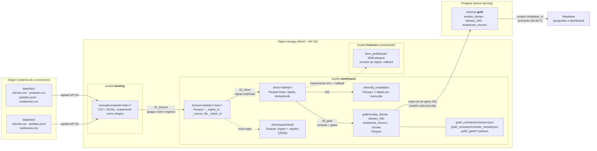
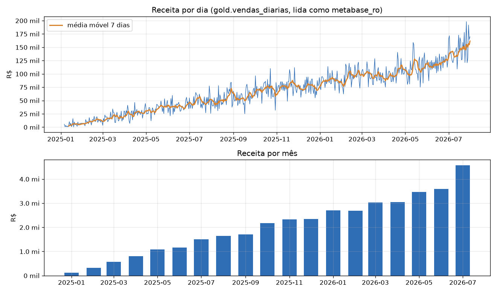

# Atividade Final · Arquitetura de Coleta no Object Storage (Bronze, Silver e Gold)

**Aluno:** Natan Nascimento Ayres · **Disciplina:** Arquitetura de Coleta e Armazenamento de Dados (Prof. Wuldson Franco) · Pós UNIPE

Caso **MercadoNordeste** (e-commerce regional): `clientes`, `produtos`, `pedidos` e `avaliacoes`, em dois lotes.
Usei a **versão pandas** dos notebooks do kit (`notebooks_pandas/`), que é a que tem contrato, gates, Postgres com usuário somente leitura e a parte de preparação para IA completas.

| Parte | Onde está |
|---|---|
| Parte 1 · Arquitetura (diagrama + explicação) | [seção abaixo](#parte-1--arquitetura) |
| Parte 2 · Evidências (notebooks executados, com saídas) | [`notebooks_pandas/`](notebooks_pandas/) + [mapa das evidências](#parte-2--evidências) |
| Parte 3 · Perguntas | [seção abaixo](#parte-3--respostas) |

---

## Parte 1 · Arquitetura



### Quem escreve e quem só lê

| Etapa | Escreve | Só lê |
|---|---|---|
| Origem → landing | credencial de ingestão do MinIO (aqui, `admin`) | — |
| landing → Bronze → Silver → Gold | o pipeline (notebooks), com a credencial do MinIO | — |
| Gold → Postgres `gold` | usuário administrador do Postgres (`aula`), dono das tabelas | — |
| Postgres → Metabase | **ninguém** | `metabase_ro`: só `USAGE` no schema e `SELECT` nas tabelas (testado no notebook 03: `DELETE`, `CREATE` e `DROP` são negados) |
| Metabase | o administrador do Metabase cria perguntas/dashboards | analistas veem os painéis |

No laboratório o pipeline usa uma única credencial `admin` no MinIO. Em produção eu separaria: uma credencial que só grava em `landing/`, outra para o pipeline (lê `landing`, grava `warehouse`) e uma só de leitura para quem consome a Gold.

### Cada etapa: o que entra, o que sai e a regra principal

| Etapa | Entra | Sai | Regra principal |
|---|---|---|---|
| **Landing** (bucket `landing`) | arquivos da origem (CSV e JSONL) | os mesmos arquivos, em `mercadonordeste/<lote>/` | não se altera: é a prova do que a origem mandou |
| **Bronze** (`warehouse/bronze/`) | arquivos da landing | um Parquet por tabela e lote, tudo como texto (CSV) ou como veio (JSON, `itens` continua lista), mais `_ingest_ts`, `_source_file` e `_batch_id` | não se limpa nada; reexecutar o mesmo lote apaga o prefixo do lote e regrava, então **não duplica** |
| **Silver** (`warehouse/silver/`) | toda a Bronze (todos os lotes) | `clientes`, `produtos`, `pedidos`, `itens_pedido`, `avaliacoes` + `quarentena` + `dq_resultados` | tipar, padronizar, deduplicar (fica a versão mais recente por chave) e **o que viola uma regra vai para a quarentena com o motivo**, nunca some. Reconciliação: entrada = Silver + quarentena |
| **Gold** (`warehouse/gold/`) | Silver | `vendas_diarias` (grão: dia), `clientes_360` (grão: cliente), `avaliacoes_resumo` (grão: produto), `chunks` (preparação para IA) + contrato | **só é publicada se todos os gates passarem** (grão, chaves, reconciliação com a Silver, colunas descritas no contrato, nenhuma PII bruta) |
| **Postgres + Metabase** | Gold | schema `gold` no Postgres; perguntas no Metabase | é cópia de serviço: o lake é a fonte da verdade; o Metabase lê com usuário somente leitura |

**Regras da Silver** (todas com destino na quarentena): produto com `preco` ou `custo` ≤ 0; pedido de cliente que não existe; item de produto que não existe na Silver; **pedido que ficou sem nenhum item válido** (regra que eu acrescentei, ver Parte 3); avaliação com nota fora de 1–5. Sem quarentena, mas corrigidos: e-mail inválido vira `NULL`, `estado` em maiúsculas, datas em formatos mistos.

**Onde ficam DQ e contrato:** o relatório de DQ fica em `s3://warehouse/silver/dq_resultados/<timestamp>.parquet` (um objeto por execução = histórico de qualidade). O contrato de dados fica em `s3://warehouse/gold/_contratos/contratos.json` (grão, dono, PII e dicionário de colunas) e o resultado dos gates de cada publicação em `s3://warehouse/gold/_gates/`.

---

## Parte 2 · Evidências

Os três notebooks em [`notebooks_pandas/`](notebooks_pandas/) estão **executados, com as saídas salvas**. O que a atividade pede e onde está:

| Evidência pedida | Notebook · seção | Resultado |
|---|---|---|
| Listagem de objetos da landing e do warehouse | 01 · Passo 1, Passo 4 e "Segundo lote" | 7 objetos na landing (lote1 + lote2); 7 Parquet em `warehouse/bronze/` |
| Experimento da "pasta" (prefixos e renomear) | 01 · Experimento | `Delimiter="/"` devolve o prefixo `mercadonordeste/lote1/`; renomear = `copy_object` + `delete_object` |
| Contagem de linhas por tabela | 01 · "Contagem de linhas" e "Contagem final" | clientes 5.601 · produtos 200 · pedidos 34.550 · avaliações 7.356 |
| Reexecução sem duplicar (idempotência) | 01 · Passo 5 e "Segundo lote" | pedidos 30.150 → 30.150 (`idempotente: True`); lote2 reexecutado com as mesmas contagens |
| Resumo da construção da Silver | 02 · Passo 2 | clientes 5.600 · produtos 197 · pedidos 33.684 · itens 55.863 · avaliações 7.306 · quarentena 1.209 |
| Quarentena por origem | 02 · "O que foi para a quarentena" e "quarentena por origem" | ver tabela na Parte 3 |
| Reconciliação (entrada = silver + quarentena) | 02 · Reconciliação + "Reconciliação completa" | fecha nas 5 tabelas (ex.: pedidos 34.000 = 33.684 + 316) |
| Relatório do DQ e tabela `dq_resultados` | 02 · Data Quality + "A tabela dq_resultados" | 7 regras OK, 1 AVISO (`not_null(email)`: 270 clientes, 4,82%) |
| Erro simulado (cancelados apagados) e recuperação | 02 · Histórico de versões | 56.778 → 49.471 linhas (sumiram 7.307); rollback → 56.778 |
| Tabela de gates com todos OK | 03 · Passo 4 | **16 de 16 OK** (e a demonstração de bloqueio com uma linha duplicada) |
| Três tabelas publicadas e o contrato | 03 · Passo 5 + "O contrato de dados publicado" | vendas_diarias 572 · clientes_360 5.600 · avaliacoes_resumo 200 |
| Tabelas gold no Postgres | 03 · Passo 6 + "Evidência: o que está no Postgres" | as 3 tabelas, com `SELECT` para `metabase_ro` e escrita negada |
| Pergunta de negócio (receita por dia) | 03 · "Pergunta de negócio" + [`docs/metabase.md`](docs/metabase.md) | 572 dias, receita total R$ 38.843.788,40 |
| 1ª execução, em que o gate bloqueou a publicação | [`docs/evidencias/03_gold_1a_execucao_gate_bloqueou.ipynb`](docs/evidencias/03_gold_1a_execucao_gate_bloqueou.ipynb) | `pedidos Gold = pedidos válidos Silver (25329)` → ERRO |



### Ambiente desta execução

- Postgres 16 local (banco `serving`, mesmo nome do `docker-compose`).
- Object storage: a máquina onde executei os notebooks não tinha Docker. Usei um servidor S3 compatível local (`moto_server`) em `localhost:9000`, com as mesmas credenciais e a mesma API do MinIO. **O código dos notebooks é o mesmo**: com `docker compose up -d` (pasta `docker/`) eles rodam contra o MinIO sem mudança. (Por isso aparece `server: Werkzeug` em uma saída do notebook 01.)
- Python com `pandas 2.3`, `pyarrow`, `boto3`, `sqlalchemy`, `psycopg2`.
- Senhas: só existem no `docker/.env` (fora do Git). O repositório traz o [`docker/.env.example`](docker/.env.example). Os valores padrão que aparecem no código dos notebooks são os de laboratório do kit e podem ser trocados por variáveis de ambiente.

**Como reproduzir:** `cd docker && cp .env.example .env && docker compose up -d`, depois `pip install -r requirements.txt` e executar `notebooks_pandas/01`, `02` e `03` em ordem. Para o Metabase, seguir [`docs/metabase.md`](docs/metabase.md).

---

## Parte 3 · Respostas

### Qual regra da Silver mandou mais registros para a quarentena e por quê?

| origem | registros | % |
|---|---:|---:|
| `itens_produto_inexistente` | 840 | 69,5 |
| `pedidos_sem_item_valido` | 276 | 22,8 |
| `avaliacoes_nota_invalida` | 50 | 4,1 |
| `pedidos_cliente_orfao` | 40 | 3,3 |
| `produtos` (preço ou custo ≤ 0) | 3 | 0,2 |

Foi a regra de **item de produto inexistente**, com 840 itens. O curioso é que esses produtos existem: são os produtos 55, 114 e 173 (Jogo de Cama Max, Sandália Basic e Castanha de Caju Pro), que vieram no cadastro com **preço negativo** (por exemplo, -418,73) e por isso foram para a quarentena pela regra de produtos. Como a checagem de itens só aceita produtos que estão na Silver, todo item vendido desses 3 produtos caiu junto: 840 itens, de 830 pedidos, somando R$ 653.858,56. Ou seja, 3 linhas erradas no cadastro geraram quase 70% da quarentena. É um efeito cascata: uma regra numa tabela "pai" derruba os registros das tabelas que dependem dela.

Isso também apareceu na segunda regra mais frequente, que foi uma regra que eu tive que criar (ver a próxima pergunta). Vale notar que o preço do item (`preco_unit`) desses pedidos é positivo, então o erro parece ser só de sinal no cadastro. A correção certa é na origem: arrumar o cadastro e reprocessar a partir da Bronze, que guardou tudo. Eu não "consertei" o sinal na Silver porque seria inventar uma regra de negócio sem confirmar com o dono do dado.

### Se a reconciliação não fechasse, o que você investigaria primeiro?

Isso aconteceu de verdade na minha primeira execução. A reconciliação da Silver (pedidos na Bronze = Silver + quarentena) fechava, mas o **gate da Gold** `pedidos Gold = pedidos válidos Silver` deu ERRO: 25.121 na Gold contra 25.329 na Silver, e a publicação foi bloqueada (a saída está em `docs/evidencias/`).

O que eu investiguei, nesta ordem:
1. **Qual lado está a mais e qual a diferença exata:** 208 pedidos. Eram pedidos válidos na Silver que não apareciam na Gold, e nenhum ao contrário.
2. **Se a diferença está na quarentena ou em algum join/filtro:** a Gold conta pedidos a partir dos itens. Cruzando, os 208 pedidos não tinham **nenhum item** em `itens_pedido` (276 no total, contando cancelados e devolvidos).
3. **Por que os itens sumiram:** estavam todos na quarentena como `itens_produto_inexistente`, a cascata dos 3 produtos com preço negativo.

A correção foi tornar a regra explícita na Silver: pedido que ficou sem nenhum item válido vai para a quarentena (`pedidos_sem_item_valido`). Assim a Silver fica coerente (todo pedido tem venda), a reconciliação continua fechando (34.000 = 33.684 + 316) e o gate passou sem eu afrouxar nada. O que eu **não** fiz foi mudar o gate para ele passar: ele estava certo.

De forma geral, quando a conta não fecha eu olharia primeiro: duplicados (contar linhas brutas vs. chaves distintas, porque a Bronze tem 550 pedidos repetidos), joins que perdem linhas (inner join no lugar de left), filtros por status, registros com chave nula e se a quarentena está gravando todas as origens.

### Que dado pessoal existe na sua arquitetura e como ele foi tratado?

| Dado | Onde existe | Tratamento |
|---|---|---|
| `nome` do cliente | landing, Bronze, Silver | **mascarado** na Gold (`Aline Pereira` → `A**** P******`, coluna `nome_mascarado`); o nome completo não sai da Silver |
| `email` | landing, Bronze, Silver | **removido** da Gold (minimização: nenhuma pergunta de negócio precisa dele). Na Silver, os 270 e-mails inválidos viram `NULL` |
| `cidade`/`estado` | até a Gold | só o `estado` vai para a Gold (`clientes_360`); a cidade não |
| `cliente_id` | até a Gold | é um pseudônimo: fica em `clientes_360`, mas **fora dos chunks** para IA |
| `comentario` (texto livre) | avaliações | antes de virar chunk, passa pela máscara de PII (e-mail, CPF e telefone viram `[EMAIL]`, `[CPF]`, `[TELEFONE]`) e por um gate que varre o texto de novo |

E o acesso é **restrito**: o Metabase lê só o schema `gold` do Postgres com o `metabase_ro` (somente `SELECT`), então quem faz BI nunca enxerga a Silver, onde estão nome e e-mail completos. O gate `nenhuma coluna de PII bruta` bloqueia a publicação se `nome`, `email`, `cpf` ou `telefone` aparecerem numa tabela Gold.

Dois pontos que eu deixaria registrados: a regex não pega nomes próprios escritos no meio de um comentário (precisaria de NER); e o bucket versionado guarda versões antigas, então para atender um pedido de exclusão pela LGPD é preciso apagar cada versão do objeto, não só o objeto atual.

### O que você mudaria nesta arquitetura se o volume de dados fosse 1.000 vezes maior?

Hoje são ~34 mil pedidos; 1.000 vezes seria ~34 milhões por carga, com ~7,5 GB só de `pedidos.jsonl` por lote. O pandas carrega tudo na memória de uma máquina, então não aguentaria. Eu mudaria:

- **Motor:** trocar pandas por **Spark** (a versão Spark do kit) ou outro motor distribuído, rodando em cluster (EMR, Databricks, Spark no Kubernetes).
- **Formato de tabela:** Parquet solto por prefixo vira **Iceberg** (ou Delta). Ganho transação, snapshots e rollback na tabela inteira (em vez de versionar objeto por objeto) e o `MERGE INTO`, que é o jeito certo de aplicar o lote2 com as atualizações de status.
- **Carga incremental:** hoje a Silver e a Gold são reconstruídas inteiras a cada execução. Com 1.000x isso fica caro; processaria só o lote novo e faria `MERGE` por chave (`pedido_id`, `cliente_id`).
- **Particionamento e tamanho de arquivo:** particionar pedidos/itens por data do pedido (dia ou mês), mirar arquivos de 128 MB a 1 GB e rodar compactação periódica para não ter milhares de arquivos pequenos.
- **Quarentena e DQ:** a quarentena guardaria o registro completo, mas particionada por data e origem, com alerta quando passar de um limite (por exemplo, mais de 1% de uma carga). O DQ calcularia as regras em uma passada só, no motor distribuído.
- **Catálogo e acesso:** catálogo gerenciado (Glue, Nessie ou REST) em vez de "tabela = prefixo", e credenciais separadas por camada.
- **Serviço:** o Postgres continua bom para as tabelas Gold agregadas (`vendas_diarias` tem 572 linhas), mas não para detalhe. Para consultas detalhadas eu colocaria um motor que lê direto do lake (Trino ou Athena) e o Metabase falaria com ele, mantendo o usuário somente leitura.
- **Orquestração:** os notebooks virariam jobs agendados (Airflow ou similar), com os gates como etapa obrigatória antes de publicar.

---

## Estrutura do repositório

```
.
├── README.md                     # Partes 1 e 3 (este arquivo)
├── notebooks_pandas/             # Parte 2: notebooks EXECUTADOS (01 bronze, 02 silver, 03 gold)
├── notebooks/                    # versão Spark do kit (não executada nesta entrega)
├── common/                       # funções do kit (Spark/Iceberg, DQ)
├── data/lote1, data/lote2        # dados de origem
├── docker/                       # docker-compose (MinIO, Postgres, Metabase) + .env.example
├── scripts/                      # verificação de ambiente e jars do Spark
└── docs/
    ├── img/receita_por_dia.png
    ├── metabase.md               # passo a passo da pergunta "receita por dia"
    ├── evidencias/               # 1ª execução do 03, com o gate bloqueando
    └── README_kit_professor.md   # README original do kit
```
