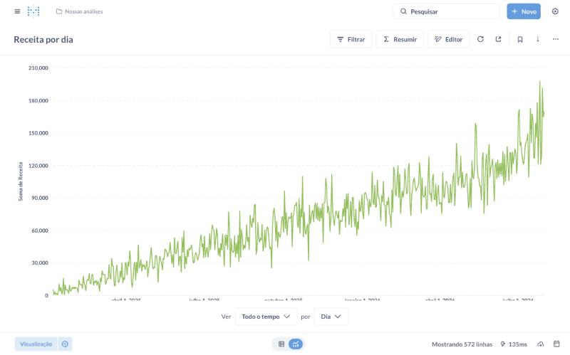
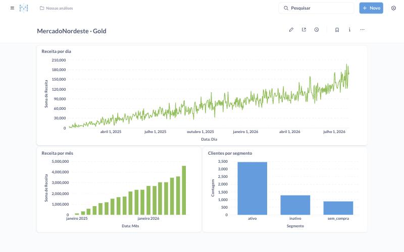

# Metabase · pergunta "Receita por dia"

Pré-requisito: `docker compose up -d` (pasta `docker/`) e o notebook `03_gold_local_pandas.ipynb` executado (ele publica as 3 tabelas no schema `gold` e cria o usuário `metabase_ro`).

1. Abrir <http://localhost:3000> e criar o usuário de administração **do Metabase**.
2. *Admin → Databases → Add database → PostgreSQL*
   - Nome de exibição: `MercadoNordeste` · Host: `postgres` (nome do serviço no Docker) · Porta: `5432` · Banco: `serving`
   - Usuário: **`metabase_ro`** (somente leitura) · Senha: a de `METABASE_PG_PASSWORD`
3. *Sync database schema now* e abrir o schema **gold**.
4. *Nova → Pergunta → gold.vendas_diarias*
   - Resumir: **Soma de receita** · Agrupar por: **data: Dia** (ou Mês) · Visualização: **Linha**
   - Salvar como "Receita por dia".
5. (Opcional) Montar também *Clientes por segmento* (`clientes_360`, contagem por `segmento`) e *Nota média por produto* (`avaliacoes_resumo`) e juntar as três num dashboard.

SQL equivalente (o mesmo executado no notebook 03 conectado como `metabase_ro`):

```sql
SELECT data::date AS dia, pedidos, receita, ticket_medio, pedidos_cancelados
FROM gold.vendas_diarias
ORDER BY dia;
```

Resultado da execução: 572 dias (jan/2025 a jul/2026), receita total **R$ 38.843.788,40**, média de R$ 67.908,72 por dia. Maior dia: 26/07/2026, R$ 198.090,34 (106 pedidos).




